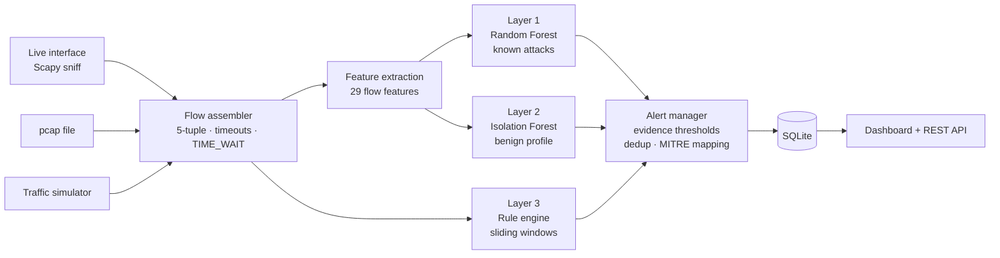

# 🛰️ NetSentinel — Hybrid ML Network Intrusion Detection System

NetSentinel is a network IDS that turns raw packets into flows and detects attacks with **three cooperating layers**:
a supervised classifier for known attacks, an unsupervised anomaly detector for unknown ones, and stateful
window-based rules for attacks that only show up in aggregate. Alerts are mapped to **MITRE ATT&CK** and shown on a live dashboard.

> Final-year cybersecurity project · Python · scikit-learn · Scapy · FastAPI

## Highlights

- **Packet → flow engine**: bidirectional 5-tuple flows with FIN/RST close, TIME_WAIT handling, idle/active timeouts, and 29 CIC-IDS2017-style features.
- **Layer 1 — Random Forest** multi-class classifier (6 attack families + benign).
- **Layer 2 — Isolation Forest** trained on benign traffic only, for zero-day / novel behaviour.
- **Layer 3 — Rule engine** (like Snort/Suricata thresholds): port scan, SYN flood, SSH brute force, DNS tunnelling, and exfiltration to rare destinations.
- **Alert hygiene**: per-class evidence thresholds, de-duplication and cooldowns — **0 false alerts/hour** on attack-free test traffic.
- **Inputs**: pcap/pcapng files, live interface sniffing, or the built-in traffic simulator.
- **Dashboard**: live KPIs, alert timeline, attack breakdown, triage workflow (open → investigating → resolved / false positive).

## Architecture



## Detected attacks

| Attack | MITRE ATT&CK | Primary detector |
|---|---|---|
| SYN flood (DoS) | T1498.001 | RF + rule R2 (≥100 half-open from many sources / 10 s) |
| Port scan (fast & stealthy) | T1046 | RF + rule R1 (≥25 ports / 60 s) |
| SSH brute force | T1110.001 | RF + rule R3 (≥10 short SSH sessions / 60 s) |
| DNS tunnelling | T1071.004 | RF + rule R4 (≥20 oversized queries / 60 s) |
| Slowloris | T1499.002 | RF + Isolation Forest |
| Data exfiltration | T1048 | RF + Isolation Forest + rule R5 (large upload to rare external host) |

## Quick start

```bash
git clone https://github.com/TrishaChetan/NetSentinel.git && cd NetSentinel
python -m venv .venv && source .venv/bin/activate      # Windows: .venv\Scripts\activate
pip install -r requirements.txt

python -m netsentinel.train              # ~1-2 min, trains on simulated traffic
uvicorn netsentinel.api:app --reload     # open http://127.0.0.1:8000 → "Live attack demo"
```

### CLI

```bash
python -m netsentinel.cli simulate --out samples/demo.pcap --duration 300   # writes a real pcap (open it in Wireshark)
python -m netsentinel.cli analyze samples/demo.pcap --json alerts.json
sudo python -m netsentinel.cli live --iface eth0                            # live sniffing (root / Npcap on Windows)
```

Docker: `docker build -t netsentinel . && docker run -p 8000:8000 netsentinel`

### REST API

| Method | Endpoint | Purpose |
|---|---|---|
| POST | `/api/pcap` | upload a pcap, returns flows + alerts |
| GET | `/api/alerts?since_id=` | alert feed |
| PATCH | `/api/alerts/{id}` | triage status |
| GET | `/api/stats` | KPIs, counts by type/severity, top sources |
| POST | `/api/demo/start` / `stop` | live replay of a simulated attack scenario |

Interactive docs at `/docs`.

## Evaluation

Train and test sets come from **different simulation seeds**, so no flow appears in both.

### Experiment 1 — known attacks (flow-level)

| Class | Precision | Recall | F1 | Support |
|---|---|---|---|---|
| BENIGN | 0.999 | 0.998 | 0.999 | 14600 |
| DNS-Tunneling | 0.983 | 0.987 | 0.985 | 1437 |
| DoS-SYNFlood | 1.000 | 1.000 | 1.000 | 4800 |
| Exfiltration | 1.000 | 1.000 | 1.000 | 12 |
| PortScan | 1.000 | 1.000 | 1.000 | 2373 |
| SSH-BruteForce | 1.000 | 1.000 | 1.000 | 720 |
| Slowloris | 1.000 | 0.998 | 0.999 | 644 |

Macro F1 0.998. DNS tunnelling is the hardest class because legitimate long DNS names (CDN, DKIM lookups) overlap with it — that's intentional in the simulator.

### Experiment 2 — zero-day simulation (leave-one-attack-out)

Each attack family is removed from training in turn; then we check what still catches it.

| Unseen attack | Flagged by Isolation Forest (per flow) | Incident detected by full pipeline |
|---|---|---|
| DNS-Tunneling | 0.1% | 3/3 |
| DoS-SYNFlood | 50.2% | 3/3 |
| Exfiltration | 100.0% | 3/3 |
| PortScan | 0.9% | 3/3 |
| SSH-BruteForce | 0.0% | 3/3 |
| Slowloris | 90.4% | 3/3 |

**Key finding:** flow-level anomaly detection catches attacks whose individual flows are *unusual in shape* (exfiltration, Slowloris) but misses attacks made of *many normal-looking flows* (scans, brute force, tunnelling). The window-based rule layer closes exactly that gap, so every unseen family was still detected end-to-end.

### Experiment 3 — false alerts

**0 alerts per hour** on 30 minutes of attack-free traffic that includes deliberately tricky benign activity (cloud backups, git-over-SSH, refused connections, websocket keep-alives, long DNS names).

Figures: `reports/confusion_matrix.png`, `reports/feature_importance.png`; full numbers in `reports/metrics.json`.

### Training on CIC-IDS2017 (for your report)

Download the *MachineLearningCVE* CSVs from the [Canadian Institute for Cybersecurity](https://www.unb.ca/cic/datasets/ids-2017.html), then:

```bash
python -m netsentinel.train --cicids path/to/MachineLearningCVE/ --max-rows 300000 --skip-zero-day
```

The column mapping is in `netsentinel/train.py` (`CIC_MAP`).

## Tests

```bash
pytest -q     # 9 tests: flow assembly, TIME_WAIT, every rule, classifier accuracy, all attacks alerted,
              # zero alerts on benign traffic, pcap upload API end-to-end
```

## Project structure

```
netsentinel/
  flows.py       packet → flow assembly, 29 features
  simulator.py   labelled traffic generator (benign, hard negatives, 6 attacks) + pcap writer
  capture.py     pcap reader, live sniffer (Scapy)
  rules.py       sliding-window rule engine (R1–R5)
  detector.py    RF + Isolation Forest + rules, alert manager, MITRE mapping
  train.py       training, 3 experiments, plots, CIC-IDS2017 loader
  store.py       SQLite alert store
  api.py         FastAPI service       templates/dashboard.html   live dashboard
  cli.py         simulate / analyze / live
tests/           pytest suite
docs/            architecture + report outline
```

## Ethics & safe use

The simulator only *generates labelled packet records* for training and testing; it does not send traffic on any network.
Run live capture only on networks you own or are authorised to monitor.

## Limitations & future work

- Encrypted payloads aren't inspected (flow statistics only) — JA3/TLS fingerprinting would add signal.
- Simulated traffic is cleaner than real networks; final report numbers should come from CIC-IDS2017 / UNSW-NB15.
- Throughput is Python-bound (a few hundred flows/s including pcap parsing); a production version would use Zeek or CICFlowMeter for flow extraction.

## License

MIT
